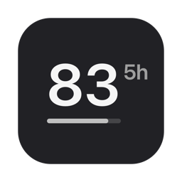
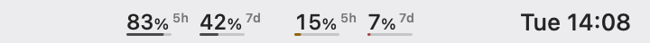

<p align="center">
  
</p>

<h1 align="center">AIquota</h1>

<p align="center"><strong>Seus limites de IA. Sempre visíveis. Zero cliques.</strong></p>

<p align="center">
  <a href="https://github.com/solbeltrame/aiquota/releases/latest"><strong>⬇️ Baixar para macOS</strong></a>
  &nbsp;·&nbsp;
  <a href="../README.md">English</a>
  &nbsp;·&nbsp;
  <a href="../CONTRIBUTING.md">Como contribuir</a>
</p>

<p align="center">
  <a href="https://github.com/solbeltrame/aiquota/blob/main/LICENSE"></a>
  <a href="https://github.com/solbeltrame/aiquota/releases/latest"></a>
  
</p>

O AIquota é um app gratuito e open source para macOS que deixa os limites de uso do Codex e do Claude Code na barra de menus. Sem dashboards, contas ou cliques extras — é só bater o olho enquanto trabalha.

<p align="center">
  <br>
  <br>
  <sub>Imagens com valores de exemplo. Funciona com barras claras e escuras.</sub>
</p>

## Baixe e use

1. [Baixe a versão mais recente](https://github.com/solbeltrame/aiquota/releases/latest) e descompacte.
2. Mova o `AIquota.app` para a pasta Aplicativos.
3. Na primeira abertura, clique com o botão direito no app e escolha **Abrir**. O AIquota ainda não é notarizado, então o macOS pede essa confirmação.

Requer macOS 14 Sonoma ou posterior, em Macs Apple silicon ou Intel. Pode usar do jeito que está — não precisa programar nem criar conta. Se curtir, dar uma estrela no repo ou compartilhar com alguém já ajuda demais 💛

## O que ele faz

- Mostra os limites de 5 horas e semanais do Codex e do Claude Code na barra de menus.
- Tem três estilos compactos: Mínimo, Microbarra e Anel.
- Permite exibir percentual disponível ou consumido, usar aparência clara/escura e receber alertas opcionais.
- Privacidade em primeiro lugar: sem servidores do AIquota, analytics ou telemetria. O app lê dados locais e consulta os limites pelo App Server do Codex.
- Não gasta tokens para consultar seus limites.

Segure ⌘ Command e arraste um indicador para perto do app de IA. O macOS controla o posicionamento na barra, então não dá para posicioná-lo automaticamente.

## Todo mundo é bem-vindo

O AIquota é open source sob a [licença MIT](../LICENSE). **Todo mundo pode usar, compartilhar, estudar e melhorar o projeto.** E não precisa escrever código para ajudar:

- Use o app e conte pra gente o que funcionou (ou o que ficou estranho) em uma [issue](https://github.com/solbeltrame/aiquota/issues/new/choose).
- Compartilhe o AIquota com alguém que possa curtir.
- Ajude com código, documentação, traduções ou suporte a outra ferramenta de IA.

Primeira contribuição open source? Chega mais! Veja as issues de [boa primeira contribuição](https://github.com/solbeltrame/aiquota/labels/good%20first%20issue), leia o [guia de contribuição](../CONTRIBUTING.md) ou mande um oi em uma issue. Também temos um [Código de Conduta](../CODE_OF_CONDUCT.md).

## Compile você mesmo

Quer mexer no app ou ajudar no desenvolvimento? Você vai precisar de macOS 14+ e Xcode 16+.

```bash
git clone https://github.com/solbeltrame/aiquota.git
cd aiquota
swift build
swift test
```

Para gerar o app independente, rode `scripts/build-app.sh`. Mais detalhes sobre integrações, privacidade, configurações e desenvolvimento estão na pasta [`docs/`](./).

## Créditos

O AIquota foi criado por **Sol Beltrame** e está aberto à colaboração de todo mundo. O cache local de uso do Claude é decodificado com [Zstandard](https://github.com/facebook/zstd) (BSD).

O AIquota não tem vínculo, endosso ou patrocínio da OpenAI ou da Anthropic. Codex, ChatGPT, Claude e Claude Code são marcas de seus respectivos donos.

## Licença

[MIT](../LICENSE) © 2026 Sol Beltrame e contribuidores do AIquota.
